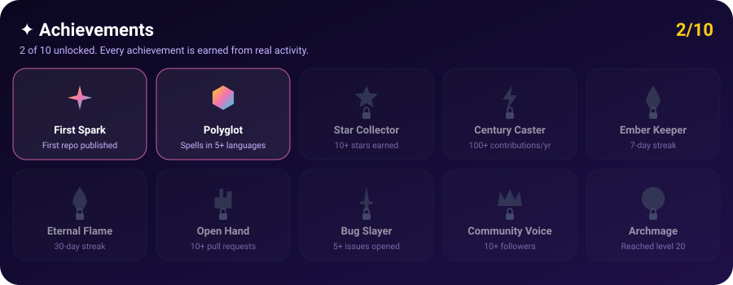

  

  <picture>
    <source media="(prefers-color-scheme: dark)" srcset="https://raw.githubusercontent.com/d-rathnayake/d-rathnayake/output/github-snake-dark.svg">
    <source media="(prefers-color-scheme: light)" srcset="https://raw.githubusercontent.com/d-rathnayake/d-rathnayake/output/github-snake.svg">
    
  </picture>

  
  

---

### ✨ About me

Web & App Developer from Sri Lanka, turning ideas into fast, beautiful and magical digital experiences.

- Building modern web apps and Android apps with a focus on clean code and premium UI.
- Obsessed with smooth animations, rich colours and typography that feels alive.
- Always learning, always experimenting, always shipping.

**7** repositories (**7** public). Most used: JavaScript, HTML, Shell.

---

### 🎮 Player card

  

XP is earned from real work: contributions, stars, repos, followers and languages.

### 🏆 Achievements

  

---

### 🌌 Contribution Sky

  

---

### 🔮 Now casting

- Polishing a 3D animated portfolio website
- Building web-based hardware controllers
- Redesigning Android utilities with a premium look

---

### 🪐 Skill Universe

  

---

### 🪄 Recent spells

- `2026-10-22` · Starred a repository in [d-rathnayake/DWS](https://github.com/d-rathnayake/DWS)
- `2026-10-20` · Cast 0 commits in [d-rathnayake/devpulse](https://github.com/d-rathnayake/devpulse)
- `2026-10-21` · Created branch `main` in [d-rathnayake/DWS](https://github.com/d-rathnayake/DWS)
- `2026-10-20` · Starred a repository in [d-rathnayake/devflow](https://github.com/d-rathnayake/devflow)
- `2026-10-18` · Cast 0 commits in [d-rathnayake/d-rathnayake](https://github.com/d-rathnayake/d-rathnayake)

---

### ⭐ Project Constellation

  

<table>
<tr>
  <td width="50%" valign="top">
    <a href="https://github.com/d-rathnayake/devpulse"><b>devpulse</b></a> 
    🗃️ DevPulse By d-rathnayake  &quot; 
    Shell &middot; 2 stars
  </td>
  <td width="50%" valign="top">
    <a href="https://github.com/d-rathnayake/DWS"><b>DWS</b></a> 
    No description yet. 
    Shell &middot; 1 star
  </td>
</tr>
<tr>
  <td width="50%" valign="top">
    <a href="https://github.com/d-rathnayake/devflow"><b>devflow</b></a> 
    No description yet. 
    1 star
  </td>
  <td width="50%" valign="top">
    <a href="https://github.com/d-rathnayake/portfolio"><b>portfolio</b></a> 
    No description yet. 
    HTML &middot; 1 star
  </td>
</tr>
</table>

---

  

✦ Generated by GitHub Actions · Last updated 2026-10-25 15:32 UTC ✦

