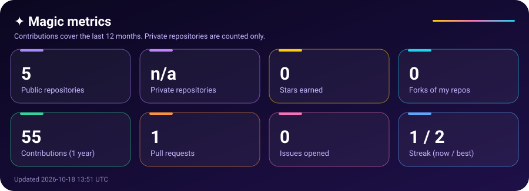
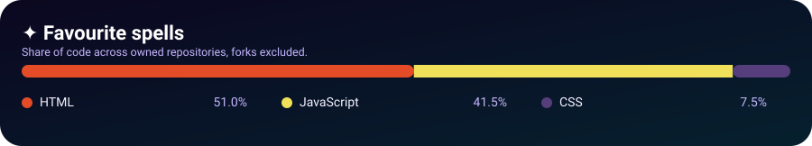

  

  <picture>
    <source media="(prefers-color-scheme: dark)" srcset="https://raw.githubusercontent.com/d-rathnayake/d-rathnayake/output/github-snake-dark.svg">
    <source media="(prefers-color-scheme: light)" srcset="https://raw.githubusercontent.com/d-rathnayake/d-rathnayake/output/github-snake.svg">
    
  </picture>

  
  

---

### ✨ About me

Web & App Developer from Sri Lanka, turning ideas into fast, beautiful and magical digital experiences.

- Building modern web apps and Android apps with a focus on clean code and premium UI.
- Obsessed with smooth animations, rich colours and typography that feels alive.
- Always learning, always experimenting, always shipping.

**5** repositories (**5** public). Most used: HTML, JavaScript, CSS.

---

### 🎮 Player card

  

XP is earned from real work: contributions, stars, repos, followers and languages.

### 🏆 Achievements

  

---

### 🔮 Now casting

- Polishing a 3D animated portfolio website
- Building web-based hardware controllers
- Redesigning Android utilities with a premium look

---

### 📊 Magic metrics

  

  

---

### 🪄 Recent spells

- `2026-10-18` · Cast 0 commits in [d-rathnayake/d-rathnayake](https://github.com/d-rathnayake/d-rathnayake)
- `2026-10-18` · Cast 0 commits in [d-rathnayake/portfolio.com](https://github.com/d-rathnayake/portfolio.com)
- `2026-10-18` · Opened a pull request in [is-a-dev/register](https://github.com/is-a-dev/register)
- `2026-10-18` · Starred a repository in [bhawan-kavinda/AWV-Browser](https://github.com/bhawan-kavinda/AWV-Browser)
- `2026-10-18` · Starred a repository in [bhawan-kavinda/dws-site](https://github.com/bhawan-kavinda/dws-site)

---

### 🧰 Tech stack

  

---

### 🚀 Featured projects

<table>
<tr>
  <td width="50%" valign="top">
    <a href="https://github.com/d-rathnayake/portfolio.com"><b>portfolio.com</b></a> 
    No description yet. 
    HTML
  </td>
  <td width="50%"></td>
</tr>
</table>

---

✦ Generated by GitHub Actions · Last updated 2026-10-18 13:53 UTC ✦

